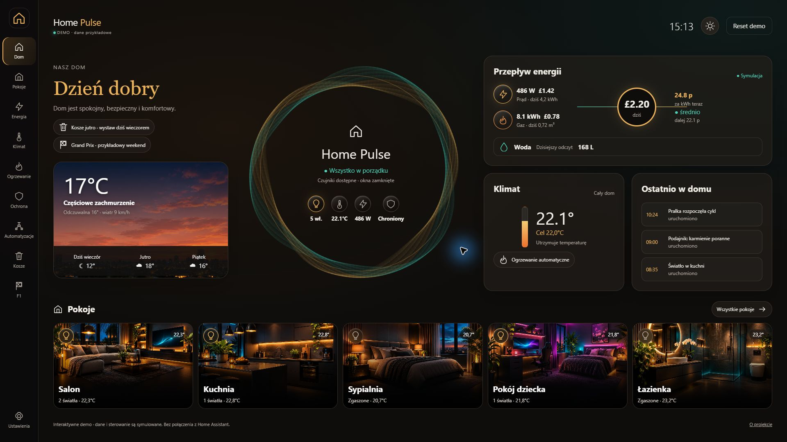
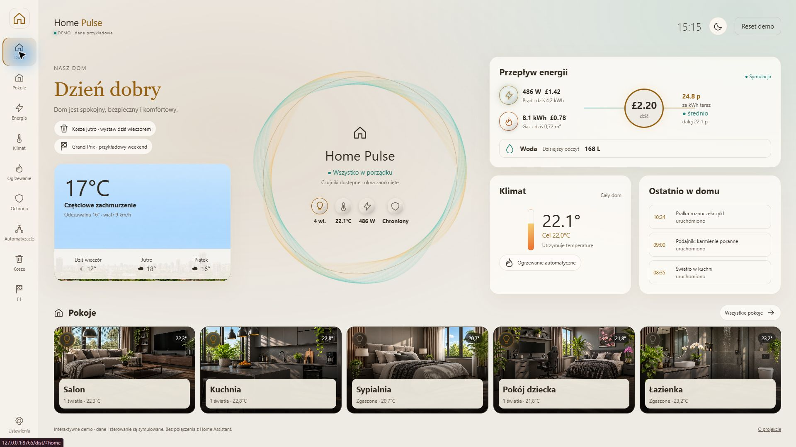
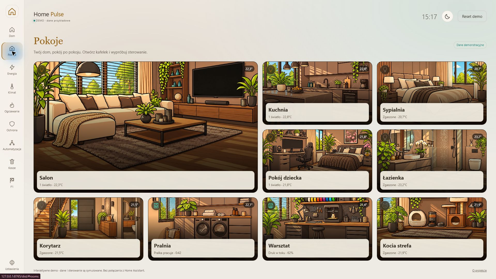

# Home Pulse

**A visual Home Assistant dashboard for everyday life at home.**

Home Pulse brings rooms, comfort, energy and household information into one interface. Its visual identity combines a gold and teal pulse ring, room photography, glass details, state-aware icons and an optional storybook Cartoon style.



**[Explore the live demo](https://krystianokris.github.io/home-pulse-demo/dist/)** · **[Project page](https://krystianokris.github.io/home-pulse-demo/)** · **[Polski](README.pl.md)**

> **Demo only.** This repository presents Home Pulse using simulated household data. It is not an installable Home Assistant card or a HACS release.

## Explore the interface

| View | What it presents |
|---|---|
| Home | House pulse, weather, energy flow, comfort, recent activity and room shortcuts |
| Rooms | Photo grid, individual room controls and glass thumbnail navigation |
| Climate | Room temperatures, humidity and comfort overview |
| Heating | Boiler visualisation, heating mode and room targets |
| Energy | Electricity, gas, separate water readings, daily costs and example hourly prices |
| Protection | Protection modes, window and safety sensor overview; no camera feeds in this demo |
| Automations | Example trigger history and searchable rules |
| Bins | Next collections and put-out reminders |
| F1 | A fictional race weekend and race-day home view |
| Settings | Themes, photography / Glass / Cartoon, ambient glow, motion and sample room editing |

The original Home Pulse project connects these views to configured Home Assistant entities and integrations. Availability depends on the installation. The standalone demo simulates a representative selection of the interface; it is not the production card and does not verify integration behaviour.

## Try it safely

- Switch sample lights and adjust room targets. Confirmation is simulated locally.
- Choose dark or light themes, Glass or Cartoon styling, and ambient glow.
- Switch the interface between Polish and English.
- Add, rename or remove a sample room, without creating any HA entities.
- Use **Reset demo** to restore the initial sample home.

All values, schedules, prices and F1 sessions are illustrative. The demo is independent of Home Assistant: no login, tokens, WebSockets, external scripts or device requests. A Content Security Policy blocks network connections from the demo scripts. Preferences and sample edits use this browser’s local storage only. A local web server or future hosting provider can still receive ordinary page and asset requests.

### Two different moods

Light theme:



Cartoon room library:



## Run locally

With Python 3 installed, run from this directory:

```sh
python -m http.server 8765 --bind 127.0.0.1
```

Open `http://127.0.0.1:8765/` for the project page, or `http://127.0.0.1:8765/dist/` for the dashboard demo. Stop the server with Ctrl+C. No installation or build step is required. The project page needs HTTP to follow the preview link reliably; the demo can also be opened directly from `dist/index.html` in browsers that support local storage for local files.

## About this repository

This repository contains only the public presentation and the standalone demo. The original Home Assistant configuration, production card, entity mapping, credentials and private data are excluded. No HACS release is provided here.

The site is hosted with GitHub Pages from the main branch. All code running in the visitor’s browser and the bundled images are public. Publication of the production dashboard is a separate decision.

No open-source licence is assigned by this demo repository. Copyright and redistribution permissions remain with the respective rights holders; public viewing does not grant a licence to redistribute the project or images.

## Files

```text
index.html             project presentation
landing.css            project page styling
dist/index.html        interactive demo entry point
dist/app.js            browser-local simulation
dist/style.css         responsive dashboard styling
dist/assets/           selected photos and Cartoon illustrations
docs/                  demo screenshots and review notes
README.pl.md           Polish description
```

Home Pulse is an independent community project for Home Assistant. It is not an official Home Assistant or Formula 1 product.
