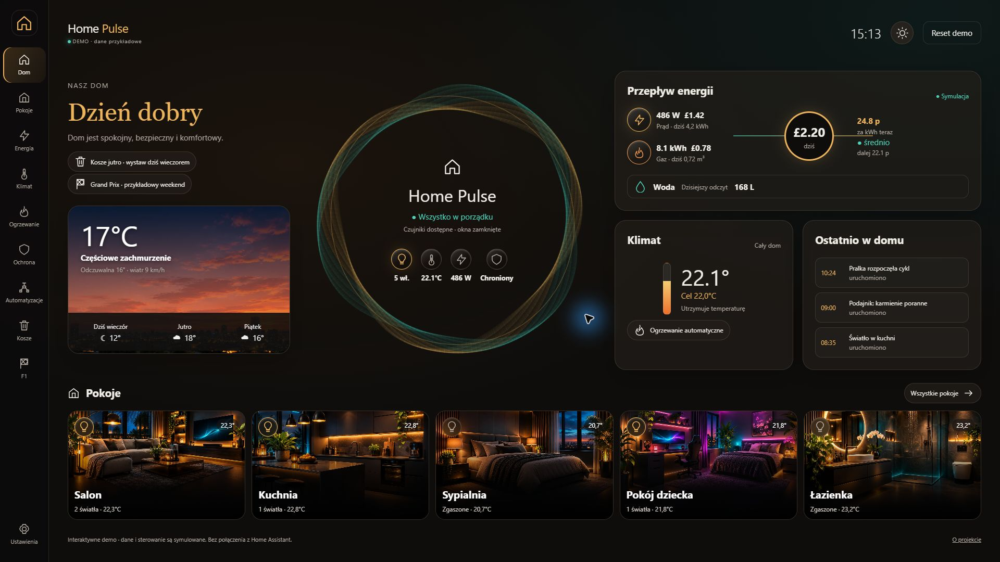
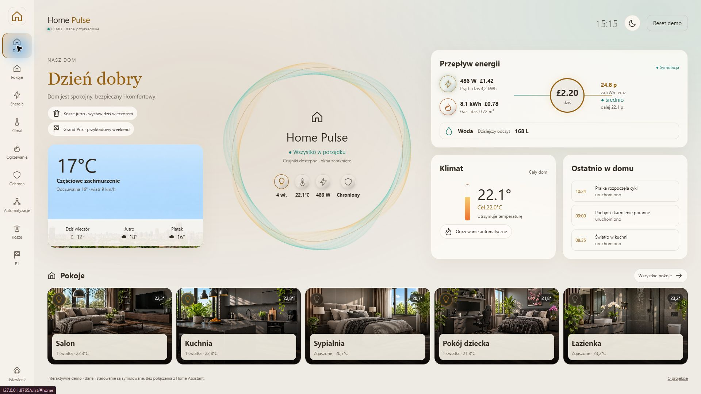
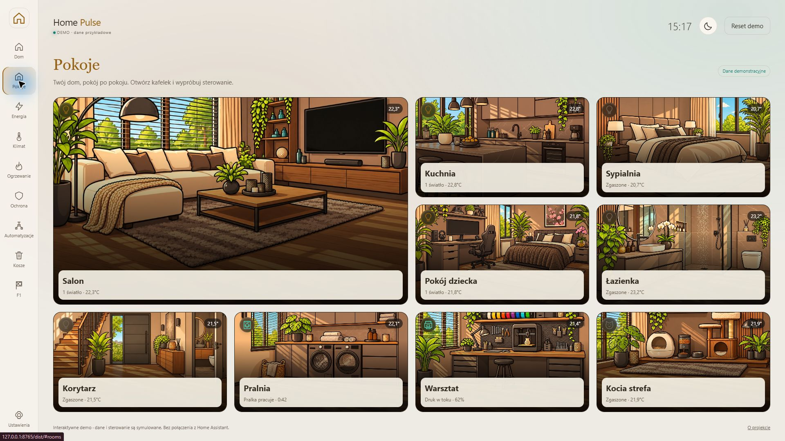

# Home Pulse

**Twój dom w jednym miejscu — wizualny dashboard dla Home Assistant.**

Home Pulse zbiera pokoje, klimat, ogrzewanie, energię i codzienne informacje w jednym interfejsie. Zamiast samej listy encji masz animowany pierścień domu, zdjęcia pokoi, szklane detale i ikony reagujące na stan.



**[Otwórz demo](https://krystianokris.github.io/home-pulse-demo/dist/)** · **[Strona projektu](https://krystianokris.github.io/home-pulse-demo/)** · **[English](README.md)**

> **Tylko demonstracja.** Repozytorium przedstawia Home Pulse na symulowanych danych. Nie jest wersją do instalacji ani paczką HACS.

## Co pokazuje Home Pulse

- **Dom:** pierścień stanu domu, pogoda, przepływ energii, komfort, ostatnie zdarzenia i skróty do pokoi.
- **Pokoje:** siatka zdjęć, osobny widok pokoju, światła, klimat i szklany pasek nawigacji.
- **Klimat:** temperatury i wilgotność w pokojach.
- **Ogrzewanie:** wizualizacja kotła, tryb domu i temperatury zadane.
- **Energia:** prąd, gaz, osobno woda, koszt dnia i przykładowy wykres cen godzinowych.
- **Ochrona:** tryby ochrony oraz stan czujników i okien. W demo nie ma kamer.
- **Automatyzacje:** przykładowa historia uruchomień i wyszukiwana lista reguł.
- **Kosze:** terminy odbioru i przypomnienie o wystawieniu.
- **F1:** wygląd zakładki wyścigowej na fikcyjnym weekendzie.
- **Ustawienia:** motyw, styl zdjęć lub Cartoon, szkło, neon, ograniczenie ruchu, język PL/EN i edycja przykładowych pokoi.

Właściwy dashboard korzysta z encji i integracji skonfigurowanych w HA. Dostępność funkcji zależy od domu. To demo jest osobną prezentacją opartą na jego wyglądzie — nie uruchamia oryginalnej karty i nie służy do testowania integracji.

## Możesz klikać swobodnie

Światła, temperatury, tryby i automatyzacje zmieniają wyłącznie stan symulacji. Możesz też dodać pokój, zmienić jego nazwę i zdjęcie. **Reset demo** odtwarza początkowy dom.

Wszystkie odczyty, daty, koszty i sesje F1 są przykładowe. Nie ma połączenia z HA, tokenów, adresu prywatnego serwera ani danych osobowych z konfiguracji. Zmiany zapisują się w pamięci tej przeglądarki. Polityka bezpieczeństwa strony blokuje połączenia sieciowe wykonywane przez skrypty demo. Serwer lokalny lub przyszły hosting nadal obsługuje zwykłe żądania strony i obrazków.

## Jasny motyw i Cartoon





## Uruchomienie

Jeśli masz Python 3, uruchom w tym folderze:

```sh
python -m http.server 8765 --bind 127.0.0.1
```

Strona projektu: `http://127.0.0.1:8765/`.

Demo: `http://127.0.0.1:8765/dist/`.

Serwer zatrzymasz przez Ctrl+C. Nie trzeba instalować dodatków ani budować projektu. Można też otworzyć `dist/index.html` bezpośrednio; obsługa pamięci lokalnej dla plików zależy od przeglądarki.

## O repozytorium

To publiczny opis projektu i samodzielna demonstracja. Prywatna konfiguracja HA, mapowanie encji, dane logowania i produkcyjna karta nie są tu udostępnione. Nie przygotowano wydania HACS.

Strona działa na GitHub Pages. Kod demonstracji i dołączone obrazy są publiczne. Wydanie właściwego dashboardu pozostaje osobną decyzją.

Repozytorium nie nadaje licencji open source. Prawa autorskie i zasady dalszego udostępniania pozostają przy właścicielach; możliwość obejrzenia demo nie oznacza zgody na rozpowszechnianie kodu lub obrazów.
